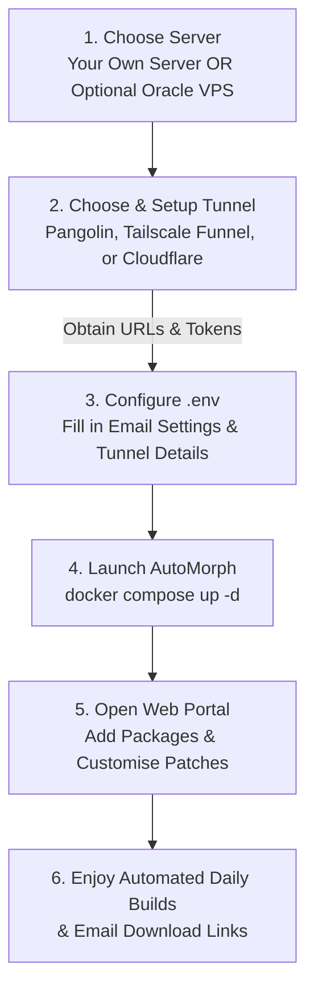

# AutoMorph Documentation Hub

Welcome to the **AutoMorph** documentation! AutoMorph is completely self-hosted and runs anywhere Docker is supported — whether on your own home server, homelab (Unraid, Proxmox, TrueNAS), Raspberry Pi, or a cloud VPS.

---

## 📚 Guides & Documentation

Choose a guide below to get started:

### ☁️ [1. Oracle Cloud Free Tier Setup (Optional)](oracle-setup.md)
* *Optional guide for users without a server*: Learn how to launch an **Always Free** VPS on Oracle Cloud Infrastructure (OCI).
* Step-by-step walkthrough covering instance creation, shape selection (`VM.Standard.E2.1.Micro`), and automated setup via cloud-init.
* Connecting via Windows PowerShell (with SSH key permission fixes) and starting Docker.
* *(If you already have your own server or VPS, you can skip this guide!).*

### 🚇 [2. Remote Access & Tunnels Guide](tunnels.md)
* Set up a tunnel **before** configuring AutoMorph so you have your access URL and tokens ready:
  * **🔴 Pangolin**: Quickest setup, free public URL (or custom domain), zero domain cost required.
  * **🔵 Tailscale Funnel**: Zero-cost public HTTPS endpoint or private mesh access.
  * **🟠 Cloudflare Tunnels**: Best choice if you own a custom domain.
* Clear explanation of tunnel tokens, compose profiles, and how links are generated in email reports.

### 📖 [3. User Guide & Web Interface](user-guide.md)
* Comprehensive tour of the web portal:
  * Adding and configuring packages.
  * Customizing patch options, repositories, and **patch aliases**.
  * Triggering builds, daily schedules, and understanding **patching strategies (Strategy 1 vs. 2)**.
  * Using a **custom keystore** for seamless in-place updates with the Morphe mobile app.
  * Enabling **Low-Spec Mode** for 1GB RAM instances.
  * Setting up automated email build notifications and downloading APKs.

---

## 🗺️ Recommended Setup Flow

---

## ⚙️ Key Configuration Files

* [`default_compose.yaml`](../default_compose.yaml): Baseline Docker Compose specification with built-in profiles for Cloudflare and Pangolin.
* [`example.env`](../example.env): Environment template for SMTP credentials, Google Play authentication, and tunnel tokens.
* [`oracle-cloud-init.yaml`](../oracle-cloud-init.yaml): Cloud-init provisioning script for Oracle instances (swaps, Docker, MTU clamping, and templates).

---

## 💡 Quick Tips

* **Low RAM Instances**: Always enable **Low-Spec Mode** in the Web Portal under *Settings* when hosting on a 1GB RAM instance.
* **Inspect Logs**: Run `docker compose logs -f automorph` from your project folder to observe active builds and server events.

---

[← Back to Main Repository](../README.md)
